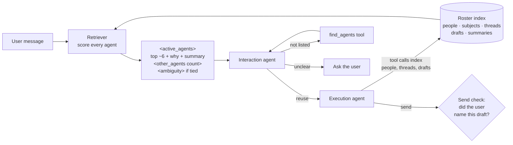

# OpenPoke: Agent Overload 🌴

[OpenPoke](https://github.com/shlokkhemani/openpoke) is an open-source take on Poke: an **interaction agent** talks to the user and delegates work to a roster of **execution agents** that persist indefinitely, each with its own memory.

**The problem.** Every turn, the interaction agent was handed the **entire roster** by name. After days of use that is hundreds of agents ("Email to Alice", "Q3 Budget Analysis", "Tokyo Restaurant Search"…), so the prompt grows without bound and the model has to find the right agent in a long, unexplained list. Routing degrades exactly when the assistant is most useful.

**The fix in one line.** Each turn, score every agent against the incoming message, show the model a **ranked shortlist of ~6 with a reason for each**, give it a **search tool** for the rest, and make it **ask instead of guess** when a request fits more than one agent or draft.

| | Before | After |
|---|---|---|
| Roster in the prompt at 1,000 agents | 10,431 tokens | **367 tokens (−96.5%)** |
| Right agent reachable (name, email, topic, follow-up) | 100% (by listing everything) | **100%** from the shortlist |
| "Did Judy reply?" with three Judys | Sent to all three | **Asks which Judy** |
| "send it" after the discussed draft already went out | Sent the *other* draft | **Asks which draft; wrong send blocked in code** |

---

## How it works



**1. Index.** The roster moved from `roster.json` (names only) to SQLite. For each agent it keeps a summary of its latest result, recent subjects, the people involved (email, name, role, count), Gmail thread ids and unsent drafts. It fills itself: every successful execution-agent tool call records the people, threads and subjects it touched. The user's own address is never indexed. Existing `roster.json` is imported once.

**2. Rank.** Every agent is scored against the message in plain Python ([`retriever.py`](server/services/execution/retriever.py), `retrieve`), about 30 ms at 1,000 agents:

```
score = 1.0·entity + 0.6·keyword + loop_scale·0.35·open_loop + context_scale·(0.25·recency + 0.5·recent_use)
```

Content signals (entity, keyword) say *which* agent the message is about; context signals (open loop, recent use, recency) carry messages that say nothing ("send it", "check again").

| Signal | What it captures | Example |
|---|---|---|
| **entity** | The message names a person or email this agent dealt with | "dave garcia" beats "dave" for Dave Garcia |
| **keyword** | Rarity-weighted word overlap with the agent's fields | "any update on the vercel offer thing" |
| **open_loop** | Unsent draft (1.0) or active reminder (0.5) | "send it" |
| **recent_use** | Agents used in the last 3 turns within a day (1.0, 0.6, 0.4) | "check again" |
| **recency** | Last activity, halving every 3 days | tie-break only |

<details>
<summary><b>Tokenizing: how "the", "send" and "please" disappear</b></summary>

The message and every agent field go through the same tokenizer (`tokenize`):

1. Lowercase and split on anything that is not a letter or digit (accented and non-Latin names stay whole).
2. Drop words shorter than 3 letters ("is", "to"), **except letter+digit pairs** such as "q3", so Q3 and Q4 stay distinct.
3. Drop about 100 stopwords: grammar (*the, and, for, about*), chat filler (*yes, okay, thanks, please*), and **command verbs** (*send, email, reply, check, find, tell*), which appear in almost every request and so say nothing about *which* agent is meant.

"Any reply from Sanya about the budget?" → `[sanya, budget]`.
</details>

<details>
<summary><b>Entity: is a person named?</b></summary>

Each agent's people come from its Gmail tool calls: recipients, cc and bcc it sent to, senders and recipients of emails it read (parsed as `Name <email>`), and addresses in its instructions. The user's own address is skipped. For each indexed person (`_entity_scores`):

- **Exact email in the message** → strength **1.0**.
- **Otherwise a name match:** the person's display-name words plus their email handle split on `.` and `_` (`judy.patel@…` → `judy`, `patel`). Any overlap with the message counts, at
  **0.7 × (0.6 + 0.4 × coverage)**, where coverage is the share of the name's parts said: "judy patel" → 0.70, "judy" → 0.56. Coverage uses the raw words, so a two-letter name like "Jo" still counts.
- An agent matching several people gets +0.1 per extra person (max +0.3); the entity score is capped at 1.0.

The match also becomes the `why` the model sees ("matches Judy Patel", "mentions alice@x.com").
</details>

<details>
<summary><b>Keyword: what else matches?</b></summary>

For the message words left after tokenizing (trailing "s" stripped, so "offers" = "offer"), against four token sets per agent: its **name**, **people** (names and handles), **subjects** and **summary** (`_keyword_scores`):

1. **Rarity (idf):** `log(1 + N / (1 + df))`, where `df` is how many of the `N` agents contain the word. A word on 1 of 100 agents weighs ~3.9; on 50 of 100, ~1.1. Common words count for little on their own.
2. **Field weight:** each word counts once, at the best field it appears in: name **3**, people **2**, subjects **2**, summary **1.5**.
3. **Score** = Σ (idf × field weight) over the words this agent has ÷ Σ (idf × 3) over the message's words.
4. **Words that appear on no agent are left out of the denominator.** "Any *update* on the vercel offer *thing*": "update" and "thing" match nothing, so they are ignored instead of diluting the real match (this alone took recall at 1,000 agents from 20% to 100%).
5. **Typos:** a message word of 5+ letters that matches nothing is mapped to roster words one edit away (insert, delete, substitute or swap) with the same first letter, at most two per word: "Sarha" → "sarah", "reveiw" → "review".
</details>

<details>
<summary><b>Guards: context must not override content</b></summary>

- **context_scale.** If the message clearly names something (any entity match, or a keyword score ≥ 0.25), recency and recent use are multiplied by **0.4**, so "update on the Q3 budget" is not hijacked by whichever agent was used last. Otherwise they count in full, which is what makes "check again" work.
- **loop_scale.** An unsent draft or reminder counts in full only when a person was named (it then picks between two threads with the same person). Otherwise it is scaled like context, so it never outranks a topic match.
- **Minimum.** An agent needs a score ≥ 0.2 and at least one real signal to be listed.
</details>

**Worked example**, "any update on the q3 budget from Pat?":

| Step | Result |
|---|---|
| Tokens | `[update, q3, budget, pat]` |
| Entity | "pat" matches *Pat Rowe* on the **Q3 Budget** agent, 1 of 2 name parts → 0.56 |
| Keyword | "update" is on no agent → ignored. "q3" and "budget" are in that agent's *name* (×3), "pat" in its *people* (×2) → ≈ 0.9. Another agent with only a "Q3 planning" subject matches "q3" alone and scores far lower |
| Context | A person was named, so recency and recent use count at 0.4× |
| Outcome | **Q3 Budget** ranks first by a wide margin |

**Ties.** After scoring, agents that match equally are reported so the model asks instead of guessing (step 4): a *person* tie when they match the message's people equally but involve different people (three Judys; several threads with the same Judy are not a tie), and a *topic* tie when no person is named and they match the same message words strongly (Q3 and Q4 budget for "the budget"). Both ignore recent use and drafts, so context cannot hide a real tie.

**Limits.** Matching is on words, so there are no synonyms ("dinner spots in Japan" does not find "Tokyo Restaurant Search"); the stopword list is hand-written; and automated senders ("LinkedIn Job Alerts") are indexed as people. The weights were tuned on test rosters and the offline eval; the retrieval log records what was shown and chosen so they can be learned later.

**3. Shortlist.** The top 6 agents scoring ≥ 0.2, plus any agent that just reported back, plus up to 2 recently active agents as a safety net for content-free follow-ups. Each is rendered with `why` it was picked, when it was last active and its summary. An `<other_agents count=N>` line points the model to `find_agents(query)`, which searches everyone before a new agent is created.

**4. Ask instead of guess.** Code adds an `<ambiguity kind="…">` note when:

| Kind | Example |
|---|---|
| `person` | "Did Judy reply?" matches three different Judys equally |
| `topic` | "How's the budget?" matches a Q3 and a Q4 budget agent |
| `draft` | "send it" when the draft just discussed already went out |
| `date` | "this Friday" said on a Friday, "next Tuesday" |
| `account` | Gmail connected but its address unknown |

**5. Check sends in code.** Each user message records which drafts it clearly refers to (named by recipient or subject, the one shown in the last reply, or "both"). The execution runtime refuses any other send and stops, so a model that ignores the note still cannot send the wrong email. Successful sends report the mailbox they went from.

**6. Make it visible.** The chat UI shows a live card per running agent (thinking, tool calls, errors) and a panel of unsent drafts and upcoming reminders.

### Code tour

| Step | File |
|---|---|
| What gets indexed | [`server/services/execution/roster.py`](server/services/execution/roster.py) (schema at the top) |
| How it gets filled | [`server/agents/execution_agent/runtime.py`](server/agents/execution_agent/runtime.py) (`_record_roster_activity`), [`server/services/execution/people.py`](server/services/execution/people.py) |
| Ranking and ties | [`server/services/execution/retriever.py`](server/services/execution/retriever.py) (`retrieve`, `_entity_scores`, `_keyword_scores`, `_tied_*`) |
| What the model sees | [`server/agents/interaction_agent/agent.py`](server/agents/interaction_agent/agent.py) (`_render_active_agents`) |
| Search fallback and choice logging | [`server/agents/interaction_agent/tools.py`](server/agents/interaction_agent/tools.py) (`find_agents`, `send_message_to_agent`) |
| Ambiguity and the send check | [`server/services/execution/ambiguity.py`](server/services/execution/ambiguity.py) |
| Evaluation | [`server/scripts/eval_roster_overhead.py`](server/scripts/eval_roster_overhead.py), [`docs/EVALUATION.md`](docs/EVALUATION.md) |

---

## Assumptions

- **Requests are mostly about people and threads.** "Did Alice reply?" needs an exact hit on Alice, so entity matching leads. Embeddings were left out: they blur Judy Brown and Judy Chen, and need another service.
- **One user, one machine.** SQLite and an in-process scan are enough; nothing new to deploy.
- **Rosters reach hundreds to low thousands of agents.** A linear scan is fine there; past ~10k I would prefilter with full-text search.
- **A wrong email is worse than an extra question.** When it is unclear which draft is meant, the send is held and the user is asked.
- **Synthetic eval data is a best case.** The live run is the reality check.

---

## How to run

**Requirements:** Python 3.10+, Node.js 18+, an [OpenRouter](https://openrouter.ai/) key, and a [Composio](https://composio.dev/) key with a Gmail auth config.

```bash
cp .env.example .env                        # add OPENROUTER_API_KEY, COMPOSIO_API_KEY, COMPOSIO_GMAIL_AUTH_CONFIG_ID
python3.10 -m venv .venv && source .venv/bin/activate
pip install -r server/requirements.txt
npm install --prefix web
```

Start both (two terminals):

```bash
python -m server.server             # API on http://localhost:8001
npm run dev --prefix web            # UI on http://localhost:3000
```

Open http://localhost:3000 → **Settings → Gmail** and connect. Reconnect after every server restart (the account id is only held in memory). Optional: `OPENPOKE_DEV_MODEL` runs every agent on one cheap model; `OPENPOKE_EXECUTION_TIMEOUT_SECONDS` sets the agent timeout (default 240).

**Tests and evaluation** (no network, no LLM calls, nothing written to `server/data`):

```bash
python -m unittest discover -s server/tests -t .          # 106 tests
python -m server.scripts.eval_roster_overhead --check     # cost and quality by roster size, exits 1 on a failed gate
```

**Inspect the live roster** (local requests only): [`/api/v1/agents`](http://localhost:8001/api/v1/agents), [`/api/v1/agents/search?q=sanya`](http://localhost:8001/api/v1/agents/search?q=sanya), [`/api/v1/agents/retrieval-stats`](http://localhost:8001/api/v1/agents/retrieval-stats).

### Try it

1. `find the most recent email from Sanya Eng`, then `any reply from Sanya?` → reuses the same agent (watch the live card).
2. `draft two short notes: one to <address A> saying "hi A" and one to <address B> saying "hi B"`, then `send it` → asks which; the drafts panel shows both.
3. `check on the Sanya thread and my latest phone bill at the same time` → two agents run in parallel.
4. `remind me in 2 minutes to stretch` → appears in the reminders panel, then fires.

---

## Results

### Offline evaluation
Seeded synthetic rosters from 5 to 1,000 agents with templated queries of known target. Full report: [docs/EVALUATION.md](docs/EVALUATION.md).

| | 20 agents | 100 agents | 1,000 agents |
|---|---:|---:|---:|
| Roster tokens per turn (old → new) | 206 → 177 | 1,024 → 264 | 10,431 → 367 |
| Right agent in shortlist: name, email, topic, filler words, "send it" | 100% | 100% | 100% |
| One typo in a topic word / a 5+ letter name | 100% / 100% | 100% / 100% | 100% / 86% |
| Shared name flagged as a tie / shared topic flagged | 100% / 100% | 100% / 100% | 100% / 100% |
| Flagged a tie when there was one right answer (over-asking) | 0% | 0% | 0% |
| Retrieval time | ~5 ms | ~7 ms | ~32 ms |

Below about 20 agents the shortlist costs *more* tokens than the old list, because summaries and reasons cost more than bare names.

### Live run
20 scripted messages against the real model and a real Gmail account, starting from an empty roster:

- **12 agents created, no duplicates.** All 7 reuses came from the shortlist.
- **No wrong-agent dispatches, no wrong emails.** Parallel requests went to the two existing agents.
- **Asked when it should:** "send it" after the coffee email went out ("did you mean the lunch draft?"), and "send it to evan" with two Evan drafts open.
- **Strict send check:** twice it held a send the user had confirmed until the draft was named. The cause is known (see below).

---

## What I tried

- **SQLite FTS5 / BM25 for keyword scoring.** Dropped: scores collapse towards zero on small rosters.
- **Context outranking content.** "Update on the Q3 budget" lost to whichever agent was used last, and an unsent draft pulled unrelated requests. Fixed by scaling context down whenever the message names something.
- **The eval found two misses**, both fixed: filler words ("any update on the X thing") diluted real matches (recall 20% → 100% at 1,000 agents), and typos matched nothing.
- **A live test sent the wrong email.** Two drafts open, the user confirmed one, then said "send it" again, and the *other* went to a different person. That led to the ambiguity notes and to checking sends in code rather than trusting the prompt.
- **Topic ties were flagged only 33–95% of the time,** because an agent named after a topic outscored ones with the topic in their subjects. Fixed by comparing *which* words each agent matched, not where.
- **"Q3" was dropped by the tokenizer** (two characters), so "the Q3 numbers" matched nothing. Letter+digit tokens are now kept.

## What I cut, and why

- **Embeddings / semantic search:** most requests hinge on exact people; a hybrid is the next step, not the first.
- **Clustering or archiving dormant agents:** useful, but ranking already keeps them out of the prompt; archiving changes what the user can get back, so it needs product decisions first.
- **Learned weights:** no real labelled data yet. The retrieval log collects it.

## What I'd do next

1. **Replay real messages**, each labelled with the agent actually used, with a held-out set; then a live pass measuring routing accuracy, duplicate-agent rate and LLM calls per task.
2. **Learn the weights** from `retrieval_choices`, which records what was shown and what was used.
3. **Add semantic similarity as one more signal**, so "dinner spots in Japan" finds "Tokyo Restaurant Search".
4. **Track drafts shown in chat as real drafts**, so a confirmed "yes" is never held by the send check.
5. **Archive or merge dormant agents** and cap each agent's own history, the same overload one level down.
6. **Show the full list below ~20 agents**, where it is cheaper.

## Other gaps found in OpenPoke

| Gap | Status |
|---|---|
| Default model `anthropic/claude-sonnet-4` retired on OpenRouter, so every call failed and the error was hidden by the log formatter | Fixed; per-agent model overrides and readable errors |
| Composio retired the Gmail connect endpoint | Fixed (`connected_accounts.link`) |
| With Gmail disconnected, agents kept paying for LLM calls to retry an unfixable error | Fixed: stop at once, and tell the user to connect Gmail |
| Hard-coded 90 s timeout cancelled searches before they could report "nothing found" | Fixed: configurable, default 240 s |
| A broad email search can load 50 full emails into one call and exceed the model's context | Open (seen live; the agent recovered with a narrower search) |
| The user's own display name and other addresses are indexed as contacts | Open |
| The Gmail account id is held only in memory, so every restart needs a reconnect | Open |

---

## Project layout
- `server/`: FastAPI application, interaction and execution agents
- `server/services/execution/`: roster index, retriever, ambiguity and send check
- `server/scripts/`: offline evaluation and a roster stress-seeding script (dev databases only)
- `server/tests/`: unit and end-to-end tests (scripted LLM, temporary roster)
- `web/`: Next.js chat UI with the live agent and pending-items panels
- `server/data/`: runtime data (ignored by git)

## License
MIT. See [LICENSE](LICENSE).
